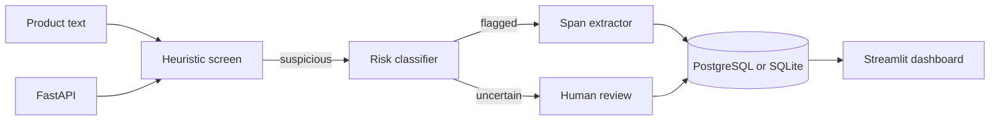

# E-Commerce Compliance Auditor

Detecting dark-pattern language in product copy

---

## Why audit product copy?

- Urgency, unsupported claims, and unclear pricing can pressure buyers.
- Reviewers need a way to find risky phrases across many listings.
- This tool prioritizes copy for review; it does not make legal decisions.

---

## Detection taxonomy

Seven labels: deceptive urgency, unsubstantiated claims, subscription trap, confirm-shaming,
drip pricing, bait and switch, and safe copy.

The final three extend the initial taxonomy with CCPA 2023 patterns.

---

## Three-stage audit

1. Regex and semantic similarity screen obvious or suspicious copy.
2. SetFit or zero-shot NLI scores the risk categories.
3. A token classifier highlights likely violation spans.

Uncertain cases go to a human review queue.

---

## System architecture

---

## Classification results

| Evaluation | Accuracy | Macro-F1 |
|---|---:|---:|
| Four classes, SetFit, 40 examples | 0.950 | 0.950 |
| Seven classes, SetFit, 70 examples | 0.871 | 0.868 |

Small hand-written test sets; see `reports/classification_report.md`.

---

## Real-world benchmark

Princeton corpus regex baseline, 1,275 texts:

- Accuracy: 0.636
- Deceptive urgency F1: 0.777
- Subscription trap F1: 0.779

Open-ended scarcity and synonym variation account for important misses.

---

## Span extraction and error analysis

- DistilBERT strict F1: 0.414.
- Overlap F1: 0.915.
- Boundary disagreements explain much of the gap.
- Negation can still cause false positives.

See `reports/span_extractor_report.txt` and `README.md`.

---

## Live demo

Run `docker compose up --build`, then open the dashboard at `localhost:8501`.

The demo includes a sample flagged product, bulk CSV audit, flagged-item export, seller
history, review queue, and Live audit page.

---

## Findings and next steps

- The end-to-end workflow is ready for local use and reviewer feedback.
- Princeton results cover the regex baseline only.
- Run the missing learning-curve and ablation studies.
- Collect a larger independently annotated test set before claiming production performance.

---

## Project contributions

Complete the contributor names and workstream ownership before presenting. Current repository
materials do not establish individual assignments.
