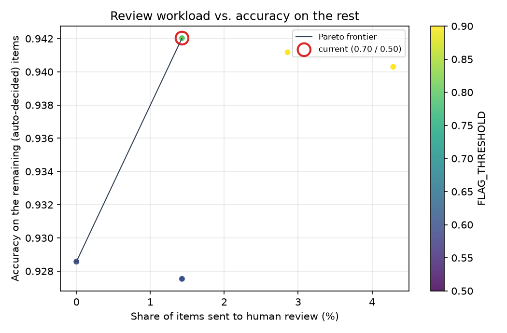

# Ablation of the three-phase design

Test set: `test_set.csv` (70 items). Phase 2 classifier: `setfit`. Thresholds for the comparison: FLAG = 0.7, REVIEW = 0.5 (current defaults).

Accuracy is measured on auto-decided items only (Flagged: gold label among the flagged categories; Passed: gold is `safe`). Items sent to human review are counted separately. Time per item excludes one-off model loading.

## Design comparison

| Design | Accuracy (auto-decided) | Auto-decided | Human review | Reach transformer | ms/item (Phase 1 + Phase 2) |
|---|---|---|---|---|---|
| (a) classifier only | 0.942 | 69 / 70 | 1 | 70 (100%) | 3.1 (0.0 + 3.1) |
| (b) regex + classifier | 0.829 | 70 / 70 | 0 | 53 (76%) | 2.3 (0.1 + 2.3) |
| (c) regex + semantic + classifier | 0.942 | 69 / 70 | 1 | 63 (90%) | 200.3 (196.4 + 3.9) |

- Phase 1 regex gate: items reaching the transformer 70 to 53 (of 70); accuracy on auto-decided items goes from 0.942 to 0.829; time per item 3.1 ms to 2.3 ms.
- Adding the semantic gate: items reaching the transformer 53 to 63; accuracy 0.829 to 0.942; time per item 2.3 ms to 200.3 ms.
- Human-review items: 1 (a), 0 (b), 1 (c).

## Threshold sweep (design c)

Accuracy on auto-decided items:

| FLAG \ REVIEW | 0.1 | 0.2 | 0.3 | 0.4 | 0.5 | 0.6 | 0.7 | 0.8 |
|---|---|---|---|---|---|---|---|---|
| 0.5 | 0.928 | 0.928 | 0.929 | 0.929 | 0.929 |  |  |  |
| 0.6 | 0.928 | 0.928 | 0.929 | 0.929 | 0.929 | 0.928 |  |  |
| 0.7 | 0.941 | 0.941 | 0.942 | 0.942 | 0.942 | 0.941 | 0.941 |  |
| 0.8 | 0.941 | 0.941 | 0.942 | 0.942 | 0.942 | 0.941 | 0.941 | 0.941 |
| 0.9 | 0.940 | 0.940 | 0.941 | 0.941 | 0.941 | 0.940 | 0.940 | 0.940 |

Share of items sent to human review:

| FLAG \ REVIEW | 0.1 | 0.2 | 0.3 | 0.4 | 0.5 | 0.6 | 0.7 | 0.8 |
|---|---|---|---|---|---|---|---|---|
| 0.5 | 1.4% | 1.4% | 0.0% | 0.0% | 0.0% |  |  |  |
| 0.6 | 1.4% | 1.4% | 0.0% | 0.0% | 0.0% | 1.4% |  |  |
| 0.7 | 2.9% | 2.9% | 1.4% | 1.4% | 1.4% | 2.9% | 2.9% |  |
| 0.8 | 2.9% | 2.9% | 1.4% | 1.4% | 1.4% | 2.9% | 2.9% | 2.9% |
| 0.9 | 4.3% | 4.3% | 2.9% | 2.9% | 2.9% | 4.3% | 4.3% | 4.3% |

Current setting: 1.4% to review, 0.942 accuracy on the rest.

## Findings

On this 70-item test set, classifier-only (a) was as accurate as the full design (c), 0.942 against 0.942, and about 65 times faster (3.1 against 200.3 ms per item). The regex gate (b) kept 17 items away from the classifier but cost about 11 points of accuracy (0.942 to 0.829): anything the regex missed was passed as safe without being classified, and the saving was only about 0.8 ms per item. The semantic gate won the accuracy back by sending 10 of those items on to the classifier, but its embedding step takes 196 of the 200 ms per item. The texts here are short and SetFit needs only about 3 ms per item on this laptop, so a gate could still pay off with long documents or a much slower classifier, which this test does not measure; and since the test set was written by the same team as the lexicon, which would flatter Phase 1, the fact that Phase 1 still did not help is notable. In the threshold sweep, accuracy on auto-decided items stayed between 0.928 and 0.942 and at most 4.3% of items went to review, with FLAG 0.7 or above giving 0.940 to 0.942. The current setting (0.7 / 0.5) sits on that plateau, so this data gives no reason to change it. One item is 1.4 points on 70 items, so small differences here are not reliable.
